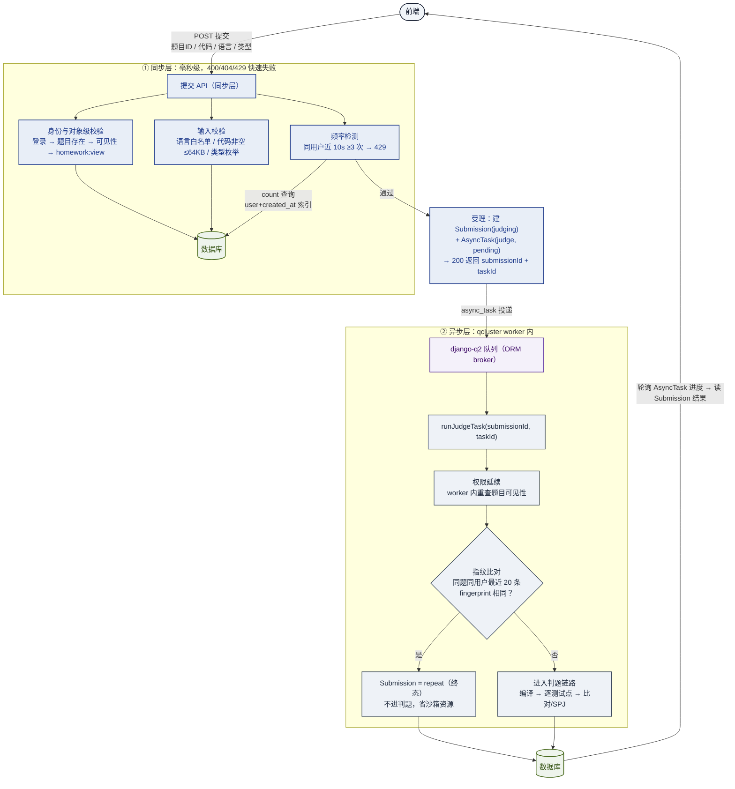
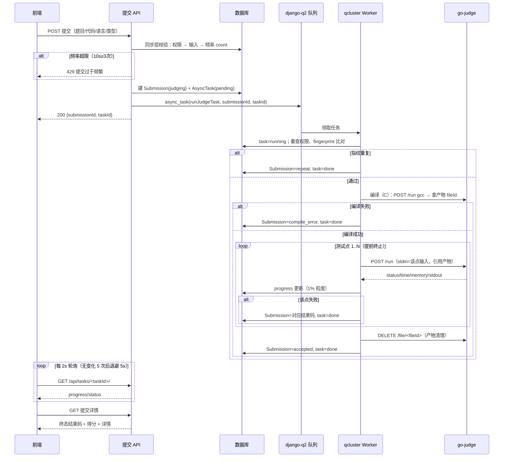

# CodeMind 教辅平台 · OJ 判题对接设计

> 更新时间：2026-10-18
> 状态：判题沙箱连通验证完成 ✅；**后端总体设计已定稿（本文第六至十二章）**，代码随批次落地
> 配套文档：《异步任务设计.md》（django-q2 承接判题）、《API设计文档.md》（接口约定）、《用户权限设计.md》（权限码）

---

## 一、认知：go-judge 是什么

我们接入的 OJ 底层是 [go-judge](https://docs.goj.ac/cn/)（v1.13.3，Go 编写）——它是一个**判题沙箱服务，不是完整 OJ**：没有题目库、用户系统、提交记录，只负责"把代码放进隔离容器跑一遍，报告运行结果"。

因此分工明确：

| 层 | 谁负责 | 干什么 |
|---|---|---|
| OJ 业务层 | **codemind 自己** | 题目管理、作业提交、答案对错判定、结果归档 |
| 判题沙箱 | go-judge（云上） | 隔离运行代码，返回 status / 耗时 / 内存 / 输出 |

> 关键认知：**go-judge 只回答"程序跑得怎么样"，不回答"答案对不对"**。
> 对错判定在 codemind 业务层做——把沙箱返回的 stdout 与题目预期输出比对（或交给 spj 判定）。

## 二、部署实例与实测记录

- 地址：`https://oj.liuwenli.cn`（nginx 反代 → go-judge，云服务器）
- 历史记忆中的 `127.0.0.1:5050` 正是 go-judge 的默认监听端口（本地开发版），线上走 nginx
- 认证：**`Authorization: Bearer <token>`**（实测确认；`X-Auth-Token` 头无效）

2026-10-18 实测记录（全部通过）：

| 探测 | 请求 | 结果 |
|---|---|---|
| 版本信息 | `GET /version`（公开） | 200，v1.13.3 / go1.27.2 |
| 沙箱配置 | `GET /config`（公开） | 200，cgroup 配置、文件存储路径 |
| 最小判题 | `POST /run`：`echo hello-oj` | `Accepted`，stdout 正确返回 |
| 超时掐断 | `POST /run`：`sleep 10` + clockLimit=1s | `Time Limit Exceeded`，runTime=1.0015s（整秒掐断）✅ |
| 文件上传 | `POST /file`（multipart `file` 字段） | 返回 fileId `"7MEHVO76"` |
| 文件引用判题 | copyIn 用 PreparedFile | `Accepted`，正确读到文件内容 |
| 文件下载/删除 | `GET/DELETE /file/<fileId>` | 200 / 200 |

## 三、端点清单与认证

| 方法 | 路径 | 认证 | 用途 |
|---|---|---|---|
| GET | `/version` | 公开 | 沙箱版本探测（健康检查可用） |
| GET | `/config` | 公开 | 沙箱能力配置 |
| POST | `/run` | Bearer | **判题**：一次请求同步跑完并返回结果 |
| POST | `/file` | Bearer | 上传文件（multipart，字段名 `file`），返回 fileId |
| GET | `/file/<fileId>` | Bearer | 下载文件内容 |
| DELETE | `/file/<fileId>` | Bearer | 删除文件（释放沙箱磁盘） |
| WS | `/ws` | Bearer | WebSocket 版判题（交互题用，远期） |

认证请求示例：

```
Authorization: Bearer <OJ_AUTH_TOKEN>
```

## 四、判题请求 / 响应格式

### 4.1 请求体 `POST /run`

```json
{
  "cmd": [{
    "args": ["/bin/sh", "-c", "echo hello-oj"],
    "env": ["PATH=/usr/bin:/bin"],
    "files": [
      {"content": ""},
      {"name": "stdout", "max": 1048576},
      {"name": "stderr", "max": 1048576}
    ],
    "cpuLimit": 1000000000,
    "clockLimit": 2000000000,
    "memoryLimit": 268435456,
    "stackLimit": 134217728,
    "procLimit": 32,
    "copyIn": {"main.py": {"content": "print(1)"}},
    "copyOut": ["output.txt"],
    "copyOutMax": 1048576
  }]
}
```

| 字段 | 单位 | 说明 |
|---|---|---|
| `args` | — | 命令行（第 0 项是程序路径，随后是参数） |
| `env` | — | 环境变量数组，**必须带 PATH** |
| `files` | — | fd 0/1/2 的 stdin/stdout/stderr 定义；stdout/stderr 需给 `max` 上限 |
| `copyIn` | — | 注入文件：`{"content"}`（小文件直接内联）/ `{"fileId"}`（引用已上传文件） |
| `copyOut` / `copyOutMax` | byte | 需回传的输出文件清单 + 总大小上限（**防止输出撑爆内存**） |
| `cpuLimit` | 纳秒 | CPU 时间限制 |
| `clockLimit` | 纳秒 | 真实等待时间限制（**TLE 的主要依据**） |
| `memoryLimit` / `stackLimit` | byte | 内存 / 栈限制 |
| `procLimit` | 个 | 进程/线程数上限（固定 32 即可） |

### 4.2 响应体（Result 数组，与 cmd 一一对应）

```json
[{
  "status": "Accepted",
  "exitStatus": 0,
  "time": 1826422,
  "memory": 2400256,
  "runTime": 27833769,
  "files": {"stderr": "", "stdout": "hello-oj\n"},
  "fileIds": {},
  "error": null,
  "fileError": []
}]
```

| 字段 | 单位 | 说明 |
|---|---|---|
| `status` | — | 运行状态（见第五节映射表） |
| `exitStatus` | — | 程序退出码 |
| `time` / `memory` | 纳秒 / byte | CPU 时间 / 峰值内存 |
| `runTime` | 纳秒 | 实际运行时长（判 TLE 用） |
| `files` | — | copyOut 与 stdout/stderr 内容 |

## 五、判题状态映射表（核心）

go-judge 共 9 种 status。**除 Accepted 外直接定案，Accepted 进入答案比对环节：**

| go-judge status | 含义 | codemind 提交状态 |
|---|---|---|
| `Accepted` | 正常结束（**未判对错**） | 进入 stdout 与预期输出比对 → 通过 / 答案错误 |
| `TimeLimitExceeded` | 超 clockLimit | 超时 |
| `MemoryLimitExceeded` | 超 memoryLimit | 内存超限 |
| `OutputLimitExceeded` | 输出超上限 | 输出超限 |
| `NonzeroExitStatus` | 非 0 退出码 | 运行错误 |
| `Signalled` | 进程被信号终止（段错误等） | 运行错误 |
| `DangerousSyscall` | 被 seccomp 拦截危险系统调用 | 运行错误 |
| `FileError` | 文件错误 | 系统错误（重试 1 次） |
| `InternalError` | 沙箱内部错误 | 系统错误（重试 1 次） |

答案比对策略（codemind 业务层，按题目配置三选一）：

| 策略 | 规则 | 适用 |
|---|---|---|
| 精确比对 | stdout 与预期输出逐字节相等 | 有固定输出的题 |
| 忽略行尾空白 | 逐行 strip 后比对 | 输出末尾多空格容错 |
| 忽略全部空白 | 去掉所有空白字符后比对 | 格式宽松的题 |

## 六、后端总体设计决策总表（2026-10-18 讨论定稿）

| # | 主题 | 结论 |
|---|---|---|
| 1 | 提交检测分层 | 同步（权限/输入/频率 10s·3次·429）+ 异步（指纹比对最近 20 条，repeat 终态拦截不进判题） |
| 2 | 任务机制 | django-q2 + AsyncTask(type='judge')，runJudgeTask 纯函数，双表状态机 12 条路径 + 定时兜底 |
| 3 | 判题执行 | 编译 1 次产物复用 fileId；逐测试点 /run + progress 上报；三档资源限制每次显式携带 |
| 4 | 数据模型 | Problem / Homework / Submission 三张表；测试用例存 DB JSON 字段永不下发；time/memory 字段落表 |
| 5 | 一期范围 | practice + homework（exam 留枚举位）；**SPJ 一期做**（Python，markdown 内嵌）；交互题/跨用户查重/考试模式二期 |
| 6 | 录题方式 | 教师端上传单 markdown 文件（题面 + 样例 + 测试点 + spj 一体）；课程组公共题库 / 教师个人题库分级 |
| 7 | 权限码 | **全部复用现有 23 码，零新增**（见第十二章） |
| 8 | 查询 API | 学生提交历史（按题/作业过滤分页）；教师教学班聚合 + 成绩导出 xlsx |
| 9 | 安全红线 | 测试点/预期输出/他人代码永不下发；WA 详情不给预期输出；对象级 404 语义 |
| 10 | 落地批次 | ①tasks 地基 ②judge.py 客户端 ③三张表 ④提交 API ⑤任务函数+比对器 ⑥兜底+测试 |

## 七、提交检测分层设计（提交 API 全链路）

### 7.1 同步层（提交 API 内，毫秒级，400/404/429 快速失败）

| 检查项 | 实现 | 拒绝时 |
|---|---|---|
| 已登录 | IsAuthenticated | 401 |
| 题目存在且对当前用户可见 | 作业题经 `getStudentTeachingClass` 反查教学班归属；练习题登录即可 | 404 |
| 提交权限码 | `homework:view` | 403 |
| 语言 ∈ 题目允许语言集 | 白名单枚举（c / python） | 400 |
| 代码非空且 ≤ 64KB | 防大报文进队列 | 400 |
| 提交类型 ∈ {practice, homework} | 白名单枚举（exam 留位二期） | 400 |
| 提交频率 | 同用户近 10 秒 ≥ 3 次（Submission 表 `(user, created_at)` 索引 count 查询） | 429 |

通过后受理：建 `Submission(status=judging)` + `AsyncTask(type='judge', total=测试点数)` → `async_task` 投递 → 200 返回 `{submissionId, taskId}`。

### 7.2 异步层（runJudgeTask 内，阶段 1-2）

1. **权限延续**：worker 内重新加载 user 重查题目可见性（防提交后作业过期/权限被撤），失败 → system_error「提交已失效」
2. **重复检测**：同题 + 同用户最近 20 条提交的 `fingerprint`（去空白 SHA256，提交时算好落库）比对，命中 → **repeat 终态，不进判题**（省沙箱资源，统一拦截不分提交类型）

### 7.3 流程图



## 八、判题任务执行规格（runJudgeTask）

### 8.1 任务函数流程（模块级纯函数，参数只传 id）

```python
def runJudgeTask(submissionId, taskId):
    """判题任务：worker 进程内执行，不依赖 request

    执行顺序：幂等闸 → 权限延续 → 重复检测 → 编译 → 逐测试点判题 → 结果落库。
    任何路径都走 _finish 收敛，保证 Submission 与 AsyncTask 状态同步。
    """
    # 阶段 0：幂等闸——Submission 已终态则直接对齐 task 返回（q2 重试防重复判题）
    # 阶段 1：权限延续——重查题目可见性，失败 → system_error「提交已失效」
    # 阶段 2：重复检测——fingerprint 比对最近 20 条，命中 → repeat
    # 阶段 3：编译（仅编译型语言）——失败 → compile_error（stderr 截断 8KB 入库）
    # 阶段 4：逐测试点循环——任一测试点失败即定案（后续点不再跑）；
    #         全部通过 → accepted；每点更新 task.progress（1% 粒度）
    # finally：编译产物 fileId 用后即删（防沙箱磁盘堆积）
```

### 8.2 编译产物复用（关键性能点）

C 语言**不能每个测试点都编译**：编译 1 次 → `copyOut` 产物 → 从响应 `fileIds["main"]` 拿 fileId（go-judge 对二进制自动转文件存储；为空则兜底走 `POST /file` 上传 `files` 内容）→ 后续测试点 `copyIn` 用 `{"fileId"}` 引用 → 判完 `DELETE /file/<fileId>`。

Python 无编译阶段，每测试点 `copyIn` 内联代码原文。

编译档独立配置：`clockLimit=10s`（编译比运行慢，独立于第七节三档运行限制）、`copyOutMax=32MB`。

### 8.3 单测试点请求形态

```
args  = ["./main"] / ["python3", "main.py"]
copyIn = {"main": {"fileId": 产物}}（C）/ {"main.py": {"content": 代码}}（Python）
files  = [{"content": 该测试点输入},          ← fd0 注入 stdin
          {"name": "stdout", "max": 8MB},
          {"name": "stderr", "max": 8MB}]
资源限制：按题目档位显式携带全部 limit 字段（不依赖沙箱默认值）
HTTP 超时：OJ_RUN_TIMEOUT(30s)，必须 > clockLimit 上限 10s
```

### 8.4 双表状态机与 12 条状态转移

```
AsyncTask:  pending ──→ running ──→ done（成功）/ failed（重试耗尽）
Submission: judging ──────────────────────→ 业务终态（不可变）
```

| # | 场景 | Submission | AsyncTask | error_detail |
|---|---|---|---|---|
| 1 | 全部测试点通过 | accepted | done | — |
| 2 | 第 k 点输出不符 | wrong_answer | done | 仅「第 k 点错误」+ 实际输出截断预览（**不给预期输出**） |
| 3 | 编译失败 | compile_error | done | 编译输出截断 8KB |
| 4 | 超 clockLimit | time_limit_exceeded | done | runTime |
| 5 | 超 memoryLimit | memory_limit_exceeded | done | memory |
| 6 | 输出超限 | output_limit_exceeded | done | — |
| 7 | 非 0 退出/信号/seccomp | runtime_error | done | exitStatus |
| 8 | 指纹重复 | repeat | done | 提示语 |
| 9 | 网络错/InternalError/FileError 重试后仍失败 | system_error | failed | 脱敏文案 |
| 10 | HTTP 401 token 失效 | system_error | failed | 不重试 + 告警日志 |
| 11 | 权限延续失败 | system_error | done | 「提交已失效」 |
| 12 | Worker 崩溃（未走到 _finish） | 停在 judging | 停在 running | 定时任务扫超 10 分钟 → system_error |

### 8.5 判题全链路时序图



## 九、数据模型草案（Problem / Homework / Submission）

```python
class Problem(models.Model):
    """题目：题面 markdown + 测试用例 JSON + 可选 spj（题库两级归属见第十二章）"""
    title = models.CharField('标题', max_length=100)
    statement_md = models.TextField('题面 markdown 原文')     # 渲染交给前端
    samples = models.JSONField('公开样例', default=list)      # [{input, output}]，可下发
    tests = models.JSONField('隐藏测试点', default=list)      # [{input, output, points}]，永不下发
    languages = models.JSONField('允许语言', default=list)    # ['c', 'python']
    tier = models.CharField('资源档位', choices=入门/基础/进阶)
    compare_strategy = models.CharField('比对策略', choices=exact/trailing/loose)
    has_spj = models.BooleanField('特殊判定', default=False)
    spj_code = models.TextField('spj 源码（Python）', blank=True)
    owner = models.ForeignKey(User, ...)                       # 归属：教师个人 / 课程组公共
    is_public = models.BooleanField('公共题库', default=False) # False=教师个人题库
    created_at / updated_at


class Homework(models.Model):
    """作业：教学班 × 题目集合 + 起止时间（practice 提交无此上下文）"""
    teaching_class = models.ForeignKey(TeachingClass, ...)     # 作业归属教学班
    title = models.CharField('作业标题', max_length=100)
    problems = models.ManyToManyField(Problem)                 # 从公共/个人题库选题
    start_at / deadline = models.DateTimeField('开始/截止时间')
    created_by = models.ForeignKey(User, ...)                  # 发布教师


class Submission(models.Model):
    """提交：三种类型合一（practice/homework，exam 留枚举位二期）"""
    user = models.ForeignKey(User, related_name='submissions')
    problem = models.ForeignKey(Problem, related_name='submissions')
    homework = models.ForeignKey(Homework, null=True)          # 练习提交为空
    language = models.CharField('语言', choices=c/python)
    code = models.TextField('代码原文')                        # 重复检测 + 教师批改要看
    fingerprint = models.CharField('去空白 SHA256 指纹', max_length=64)  # 提交时算好
    submit_type = models.CharField('提交类型', choices=practice/homework)
    status = models.CharField('状态', choices=judging/accepted/wrong_answer/
                               compile_error/time_limit_exceeded/memory_limit_exceeded/
                               output_limit_exceeded/runtime_error/repeat/system_error)
    passed_points = models.PositiveIntegerField('通过测试点数', default=0)
    time_used = models.BigIntegerField('最大单点耗时（纳秒）', null=True)   # 学情分析原料
    memory_used = models.BigIntegerField('最大单点内存（byte）', null=True)
    error_detail = models.TextField('错误详情（脱敏）', blank=True)
    task = models.OneToOneField(AsyncTask, null=True)          # 判题任务，前端轮询
    created_at / judged_at
    # 索引：(user, created_at) 频率检测；(problem, user) 重复检测窗口查询
```

要点：测试用例与题面同表（单校规模 JSON 完全扛得住）；`fingerprint` 落库让重复检测只比对字段不拉代码全文；`code` 保留原文供二期跨用户查重与教师批改。

## 十、Markdown 录题格式（单文件承载整道题）

教师/课程组上传一个 `.md` 文件，后端解析出题面、样例、测试点、spj。**约定代码块标签**：

````markdown
# 两数之和

## 题目描述
输入两个整数 a 和 b，输出它们的和。
（题面 markdown 正文，含 ## 小节、列表、行内代码等）

## 样例
```input-sample
1 2
```
```output-sample
3
```

（以下代码块是隐藏测试点，学生不可见）
```input
100 200
```
```output
300
```

（spj 题加这段，普通题不放）
```spj-python
import sys
def main():
    with open(sys.argv[2]) as f:
        user_out = f.read().strip()
    with open(sys.argv[3]) as f:
        expect = f.read().strip()
    sys.exit(0 if user_out == expect else 1)
main()
```
````

**解析规则**（后端状态机；上传者是可信教师但仍按脏数据校验）：

- `input-sample/output-sample` 成对 → 公开样例（题目详情接口可下发）
- `input/output` 成对 → 隐藏测试点（进 `tests` JSON，永不下发）；input 为空串即「无输入」
- 约束：必须成对（不配对 → 400 拒绝整题）、上限 20 组、单组 ≤ 256KB、至少 1 组测试点
- `spj-python` 代码块 → 存 `spj_code` + 置 `has_spj`，入库前 `ast.parse` 语法校验
- 其余 markdown 正文 → 存 `statement_md`

## 十一、SPJ 设计（一期，Python only）

**定位**：三策略比对覆盖不了的题（多解输出、浮点误差、部分分）。spj 本身是一段程序，跑在沙箱里判定。

**判题流程**（spj 题多一次沙箱调用）：

```
跑用户程序（正常判题链路）→ 拿用户输出
  ▼
POST /run 跑 spj：
  argv  = [checker.py, input文件, user_out文件, expected文件]  ← 经典三参数协议
  copyIn = 三个文件 + spj 源码
  exitStatus = 0 → AC；非 0 → WA；stdout = 判定说明（可入库 error_detail）
```

**决策**：一期限定 Python（免编译、判题链路零改动；C 版 spj 每次判题需先编译，二期）；spj 代码存 `Problem.spj_code`，随 markdown 一并录入；spj 运行资源限制同题目档位。

## 十二、题库权限分级与查询 API

### 12.1 权限分级（全部复用现有 23 码，零新增）

| 角色 | 权限码 | 能力 |
|---|---|---|
| 课程组 | `question_bank:manage` | **公共题库** CRUD（is_public=True），全平台教师可用 |
| 教师 | `homework:bank` | **个人题库** CRUD（is_public=False），仅自己执教的班级可用 |
| 教师 | `homework:publish` | 从公共 + 个人题库选题 → 组 Homework 挂教学班 |
| 学生 | `homework:view` | 提交与查看，无任何写权限 |

### 12.2 查询 API 形态

- 学生：`GET /api/submissions/`（自己的提交历史，按题/作业过滤分页）；`GET /api/submissions/<id>/`（详情，对象级：非本人 404，超管放行）
- 教师：`GET /api/teacher/teaching-classes/<id>/submissions/`（教学班提交聚合：谁没交、通过率、成绩导出 xlsx——`analysis:view` 权限 + `getTeacherTeachingClass` 对象级校验）
- 代码原文访问：学生仅自己的 code；教师仅自己教学班学生的 code（对象级 404 语义）

## 十三、资源限制策略（分档）

按题目难度分档（题目的时间/内存限制取档位上限以内，服务端写死下限兜底）：

| 档位 | cpuLimit | clockLimit | memoryLimit | copyOutMax | 适用 |
|---|---|---|---|---|---|
| 入门 | 2s | 5s | 256 MB | 16 MB | 语法练习、填空 |
| 基础 | 2s | 5s | 256 MB | 16 MB | 常规作业题 |
| 进阶 | 5s | 10s | 512 MB | 32 MB | 算法题 |

固定项：`procLimit=32`、stdout/stderr 各 `max=8MB`、`copyOutMax` 按档位（防输出撑爆 worker 内存）。
**每次请求显式携带全部 limit 字段**——不依赖沙箱默认值，防止服务端默认配置变更影响判题公平。
编译档独立：`clockLimit=10s`、`copyOutMax=32MB`（编译比运行慢）。

## 十四、安全设计

1. **凭证不入仓库**：token 只从环境变量 `OJ_AUTH_TOKEN` 读取（settings.py 已配置），开发/生产各自注入；泄露后立即轮换
2. **沙箱侧**（go-judge 已提供）：cgroup 资源隔离、seccomp 拦截危险系统调用、网络默认隔离
3. **注入方式**：`copyIn` 只用 `content`（代码文本内联）或 `fileId`（走 /file 上传），**禁用 `LocalFile`（src 绝对路径）**——避免意外暴露宿主机文件
4. **输出防护**：`copyOutMax` + stdout/stderr `max` 双重限流；结果入库前校验结构（status 必须属于 9 种枚举、stdout 必须存在）
5. **文件清理**：`/file` 上传的 fileId 用后即 `DELETE`，防沙箱磁盘堆积（django-q2 定时任务可兜底）
6. **重试上限**：单提交最多 2 次（q2 max_attempts=2 + 幂等闸），防恶意提交放大判题负载
7. **测试数据保密链**：测试点存 DB 永不下发；WA 的 error_detail 只给「第 k 点错误」+ 实际输出截断预览，预期输出与 spj 判定细节不进详情；样例数据（input-sample）是唯一可下发的用例
8. **代码访问分级**：学生仅本人代码、教师仅本教学班学生代码（对象级 404，与全项目语义一致）
9. **提交限流双层闸**：频率闸（10s·3次·429）拦短时暴击 + 队列闸（用户 pending/running ≤ 3，异步任务设计 8.6）拦积压滥用

## 十五、异常处理

| 异常 | 处理 |
|---|---|
| 网络错误 / 5xx / 超时 | 重试 1 次 → 仍失败标记「系统错误」，不判为答错 |
| HTTP 401 | token 失效，**不重试**，任务标记失败并告警（提示运维轮换 token） |
| HTTP 400 | 请求体构造错误——代码 bug，记日志排查，不重试 |
| `InternalError` / `FileError` | 重试 1 次 → 仍失败标记「系统错误」 |
| 响应结构非法 | 按系统错误处理（防沙箱异常响应污染业务数据） |

## 十六、配置说明

`codemind/settings.py` 已新增（2026-10-18）：

```python
OJ_BASE_URL = os.environ.get('OJ_BASE_URL', 'https://oj.liuwenli.cn')
OJ_AUTH_TOKEN = os.environ.get('OJ_AUTH_TOKEN', '')   # Bearer 凭证，只走环境变量
OJ_RUN_TIMEOUT = 30   # 单次判题 HTTP 超时（秒）
```

环境变量注入方式：
- **Windows 开发**：`setx OJ_AUTH_TOKEN "..."` 后重启终端
- **生产（Linux）**：systemd 服务文件 `Environment=OJ_AUTH_TOKEN=...`，与《异步任务设计.md》部署章节同文件管理

## 十七、测试设计（判题矩阵）

| 层 | 用例 |
|---|---|
| 提交 API | 越权矩阵（未登录/非学生/题目不可见 404/频率 429）；受理返回双 ID |
| 任务函数单测 | 直接同步调用 runJudgeTask（不走队列），mock 判题客户端 HTTP 层 |
| 判定矩阵 | AC 全通过；WA 第 k 点 → **断言后续测试点不再跑**（mock 的 /run 调用次数）；CE；TLE；repeat → **断言零 HTTP 调用** |
| 比对器 | 三策略各一组用例（行尾空格、全空白差异） |
| 幂等 | Submission 已终态再跑 → 直接返回、状态不变、零 HTTP |
| 资源 | 产物 fileId 判后 DELETE 被调用；progress 单调不减 |
| 异常 | mock 网络错 → 重试 1 次 → system_error；401 → 不重试 |
| 保密 | WA 的 error_detail 不含预期输出内容；题目接口不含 tests 字段 |
| markdown 解析 | 正常题/spj 题/样例题；不配对 400；超 20 组 400；spj 语法坏 400 |

## 十八、落地批次规划

| 批次 | 内容 | 依赖 |
|---|---|---|
| ① tasks 地基 | 装 django-q2、AsyncTask 模型 + TYPE_JUDGE、Q_CLUSTER 配置 | 无（异步任务设计第十二章步骤） |
| ② 判题客户端 | `teaching/judge.py`：submitRun/uploadFile/deleteFile 封装 | go-judge 云实例（已通） |
| ③ 模型 | Problem / Homework / Submission 三张表 + 迁移 | ① |
| ④ 提交 API | 同步层（校验/频率/受理）+ 提交查询 API | ③ |
| ⑤ 任务函数 | tasks_judge.py（第八章规格）+ 答案比对器 + spj | ①②③ |
| ⑥ 收尾 | markdown 解析器 + 录题 API、定时兜底、测试矩阵、文档 | ⑤ |

## 十九、待办（随批次实现）

- [ ] `teaching/judge.py` 判题客户端封装（submitRun / uploadFile / deleteFile）
- [ ] 沙箱镜像语言实测：确认 python / gcc 编译链是否已装（当前仅实测 /bin/sh），缺什么在服务器补镜像
- [ ] 答案比对器（精确 / 忽略行尾空白 / 忽略全部空白）
- [ ] markdown 解析器（input/output 代码块 → 题目数据）
- [ ] AsyncTask 补 TYPE_JUDGE + 判题任务接入 django-q2
- [ ] 定时兜底：扫 judging 超 10 分钟的提交置 system_error
- [ ] 跨用户抄袭检测（二期）
- [ ] exam 考试模式（二期）：限时锁定、交卷封存
- [ ] 交互题 `/ws` 支持（远期）
- [ ] C 版 spj（二期，每次判题先编译）
